# 一款基于BS的美食网站的设计与实现--论文

> 🎓 **计算机毕业设计 · 一款基于BS的美食网站的设计与实现--论文**
>
> 本仓库只放**项目介绍 + 运行截图**（截图是站点带水印的原图，存在仓库 `images/` 里）。
>
> 👉 **完整可运行源码 / 数据库脚本 / 部署文档：[点我获取](https://geekcode.top/archives/%E4%B8%80%E6%AC%BE%E5%9F%BA%E4%BA%8EBS%E7%9A%84%E7%BE%8E%E9%A3%9F%E7%BD%91%E7%AB%99%E7%9A%84%E8%AE%BE%E8%AE%A1%E4%B8%8E%E5%AE%9E%E7%8E%B0-%E8%AE%BA%E6%96%87?utm_source=github)**
>
> 💬 咨询微信：**ir9372**　|　🌐 更多项目：[极客代码 geekcode.top](https://geekcode.top/?utm_source=github)
>
> 📌 项目详情页：<https://geekcode.top/archives/%E4%B8%80%E6%AC%BE%E5%9F%BA%E4%BA%8EBS%E7%9A%84%E7%BE%8E%E9%A3%9F%E7%BD%91%E7%AB%99%E7%9A%84%E8%AE%BE%E8%AE%A1%E4%B8%8E%E5%AE%9E%E7%8E%B0-%E8%AE%BA%E6%96%87?utm_source=github>

<table><td width="230" align="center"> <b>扫码加微信 ir9372</b></td><td valign="middle">📦 源码 = 项目介绍 + 全部运行截图 + 数据库 + 部署文档 👉 点上方任意截图，直接跳到 <b>极客代码 geekcode.top</b> 详情页</td></table>

---

<h1>一款基于BS的美食网站的设计与实现--论文</h1>
<h2>项目概述</h2>

本项目是一款基于BS架构的美食网站，旨在为美食爱好者与餐饮商家提供高效的信息交互平台。系统核心功能涵盖餐厅信息展示、美食资讯发布、美食文化交流及公告资讯管理。前台面向普通用户，提供浏览、搜索、评论及收藏服务；后台面向管理员，实现内容维护、用户管理及订单处理。技术架构采用Spring Boot后端框架结合Vue前端集成方案，利用MyBatis-Plus进行数据持久化，并通过Shiro保障系统安全。该项目适用于中小型餐饮企业数字化运营及个人用户获取美食推荐场景，有效解决了传统美食信息分散、互动性差的问题，提升了用户体验与管理效率。

<h2>技术架构</h2>

本系统采用前后端分离但集成部署的架构模式（vue-integrated），具体技术选型如下：

<ol>
<li><strong>后端架构</strong>：基于Java语言开发，核心框架选用Spring Boot，利用其自动配置特性快速搭建RESTful API服务。数据访问层采用MyBatis-Plus，在保留MyBatis灵活性的基础上简化CRUD操作，提升开发效率。数据库连接使用MySQL Connector，通过JDBC驱动实现数据交互。</li>
<li><strong>安全机制</strong>：引入Apache Shiro作为权限控制框架，负责用户身份认证与会话管理，确保系统接口访问的安全性。</li>
<li><strong>前端架构</strong>：采用Vue.js框架构建用户界面，通过Axios或Fetch与后端API进行异步通信，实现单页面应用（SPA）的高效渲染与交互体验。</li>
<li><strong>数据存储</strong>：使用MySQL关系型数据库存储用户信息、餐厅数据、美食文章、评论内容及订单记录等结构化数据。</li>
</ol>

<a href="https://geekcode.top/archives/%E4%B8%80%E6%AC%BE%E5%9F%BA%E4%BA%8EBS%E7%9A%84%E7%BE%8E%E9%A3%9F%E7%BD%91%E7%AB%99%E7%9A%84%E8%AE%BE%E8%AE%A1%E4%B8%8E%E5%AE%9E%E7%8E%B0-%E8%AE%BA%E6%96%87?utm_source=github" title="查看完整源码">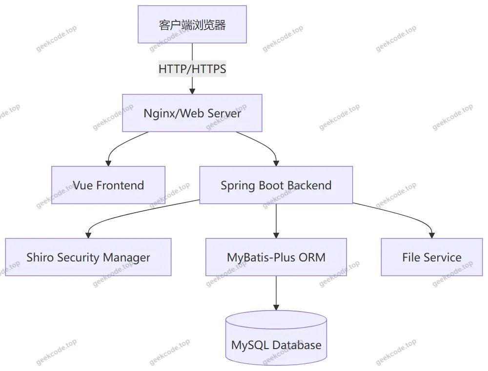</a>

<h2>功能模块</h2>
<h3>前台用户端</h3>

前台界面设计简洁直观，主要包含以下导航菜单与功能区域：

<ul>
<li><strong>首页</strong>：展示轮播图、最新公告及热门推荐美食信息。</li>
<li><strong>餐厅信息</strong>：列表展示入驻餐厅的基本概况，支持查看详情。</li>
<li><strong>美食信息</strong>：分类展示各类美食介绍，关联菜系分类进行筛选。</li>
<li><strong>美食文化</strong>：发布与美食相关的文化文章，支持用户阅读与评论。</li>
<li><strong>公告资讯</strong>：展示平台发布的最新动态与通知。</li>
<li><strong>个人中心</strong>：包含“关于我们”、“我的收藏”等功能入口，允许用户查看历史收藏内容及平台简介。</li>
<li><strong>评论互动</strong>：在餐厅信息、美食信息及美食文化详情页下方，提供评论区供用户发表看法。</li>
</ul>
<h3>后台管理端</h3>

后台管理系统提供了全面的数据管理与业务处理能力，路由覆盖以下模块：

<ul>
<li><strong>基础信息管理</strong>：</li>
<li><strong>系统简介</strong>：编辑平台介绍文本。</li>
<li><strong>关于我们</strong>：维护联系人与公司信息。</li>
<li><strong>轮播图管理</strong>：上传并配置首页展示图片。</li>
<li><strong>配置管理</strong>：修改系统全局参数。</li>
<li><strong>内容管理</strong>：</li>
<li><strong>菜系分类</strong>：新增、编辑、删除美食所属的菜系类别。</li>
<li><strong>餐厅管理</strong>：录入餐厅基本信息，审核商家资料。</li>
<li><strong>餐厅信息</strong>：发布具体的餐厅详情内容。</li>
<li><strong>美食文化</strong>：撰写并发布美食相关文章。</li>
<li><strong>美食信息</strong>：发布具体菜品或美食攻略信息。</li>
<li><strong>公告资讯</strong>：发布平台新闻与通知。</li>
<li><strong>用户与互动管理</strong>：</li>
<li><strong>用户管理</strong>：查看注册用户列表，执行禁用或删除操作。</li>
<li><strong>评论管理</strong>：分别对“餐厅信息评论”、“美食信息评论”、“美食文化评论”进行审核、回复或删除。</li>
<li><strong>业务管理</strong>：</li>
<li><strong>订单管理</strong>：查看和处理用户提交的订单状态（如待支付、已完成等）。</li>
</ul>
<h2>用户角色与权限</h2>

根据代码结构与截图分析，系统主要存在两类用户角色，其权限分配如下：

<h3>1. 普通用户（前台访客/注册者）</h3>
<ul>
<li><strong>访问权限</strong>：可浏览所有前台公开页面，包括首页、餐厅列表、美食详情、文化文章及公告。</li>
<li><strong>操作权限</strong>：</li>
<li><strong>评论</strong>：可在餐厅信息、美食信息、美食文化详情页发表评论。</li>
<li><strong>收藏</strong>：可将感兴趣的内容添加至个人收藏列表。</li>
<li><strong>个人信息</strong>：进入个人中心查看“关于我们”及“我的收藏”。</li>
<li><strong>下单</strong>：根据后台存在的<code>orders</code>路由及<code>CartController</code>，推测用户具备加入购物车及提交订单的能力（具体流程依前端逻辑而定）。</li>
</ul>
<h3>2. 系统管理员（后台登录者）</h3>
<ul>
<li><strong>访问权限</strong>：通过<code>/login</code>页面登录后，拥有访问所有后台管理路由的权限。</li>
<li><strong>操作权限</strong>：</li>
<li><strong>增删改查</strong>：对所有内容模块（餐厅、美食、文化、公告、分类、用户、评论、订单、配置、轮播图等）执行完整的CRUD操作。</li>
<li><strong>审核管理</strong>：对用户提交的评论进行监控与处理。</li>
<li><strong>账号管理</strong>：维护普通用户的账号状态。</li>
</ul>
<h2>项目特色与创新点</h2>
<ol>
<li><strong>垂直领域精细化运营</strong>：区别于通用电商网站，本项目专注于“美食”垂直领域，引入了“菜系分类”与“美食文化”模块，不仅提供交易属性，更强调内容分享与文化传承，增强了用户粘性。</li>
<li><strong>多维度的互动体系</strong>：建立了针对“餐厅”、“美食信息”、“美食文化”三个独立维度的评论系统，实现了用户对不同粒度内容的精准反馈，有助于构建真实的口碑评价体系。</li>
<li><strong>轻量级且安全的架构</strong>：采用Spring Boot + MyBatis-Plus组合，在保证高性能数据操作的同时，通过Shiro框架实现了细粒度的权限控制，确保了后台管理数据的安全性与完整性。</li>
<li><strong>前后端一体化部署优势</strong>：采用vue-integrated模式，简化了部署流程，降低了运维复杂度，适合中小型团队快速迭代与维护。</li>
</ol>
<h2>部署环境</h2>

为确保项目正常运行，需准备以下软件环境：

<ol>
<li><strong>操作系统</strong>：Windows 10/11, macOS, 或 Linux (CentOS/Ubuntu)。</li>
<li><strong>Java运行环境</strong>：JDK 1.8 或 JDK 11（建议版本以匹配Spring Boot依赖为准）。</li>
<li><strong>数据库</strong>：MySQL 5.7 或 MySQL 8.0，需预先创建对应数据库实例并导入SQL脚本。</li>
<li><strong>构建工具</strong>：Maven 3.6+（用于后端依赖管理）。</li>
<li><strong>Node.js环境</strong>：Node.js 14.x 或更高版本（用于前端Vue项目的编译与打包）。</li>
<li><strong>Web服务器</strong>：Nginx（可选，用于静态资源托管）或 Spring Boot内置Tomcat。</li>
<li><strong>浏览器</strong>：Chrome, Firefox, Edge等现代主流浏览器。</li>
</ol>
<h2>五、技术特性</h2>
<ul>
<li>前后端集成部署，前端资源打包至后端 static 目录</li>
<li>使用 MyBatis-Plus 简化数据访问层开发</li>
<li>集成 Shiro 权限框架实现角色权限控制</li>
</ul>
<h2>六、功能模块截图</h2>
<h3>前台用户端</h3>
<h4>前台-菜系分类列表</h4>

<h4>前台-餐厅列表</h4>

<a href="https://geekcode.top/archives/%E4%B8%80%E6%AC%BE%E5%9F%BA%E4%BA%8EBS%E7%9A%84%E7%BE%8E%E9%A3%9F%E7%BD%91%E7%AB%99%E7%9A%84%E8%AE%BE%E8%AE%A1%E4%B8%8E%E5%AE%9E%E7%8E%B0-%E8%AE%BA%E6%96%87?utm_source=github" title="查看完整源码">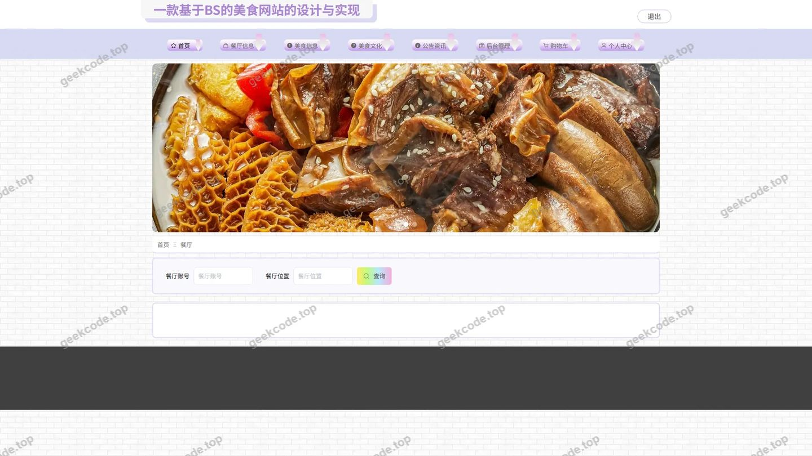</a>

<h4>前台-餐厅信息列表</h4>

<a href="https://geekcode.top/archives/%E4%B8%80%E6%AC%BE%E5%9F%BA%E4%BA%8EBS%E7%9A%84%E7%BE%8E%E9%A3%9F%E7%BD%91%E7%AB%99%E7%9A%84%E8%AE%BE%E8%AE%A1%E4%B8%8E%E5%AE%9E%E7%8E%B0-%E8%AE%BA%E6%96%87?utm_source=github" title="查看完整源码">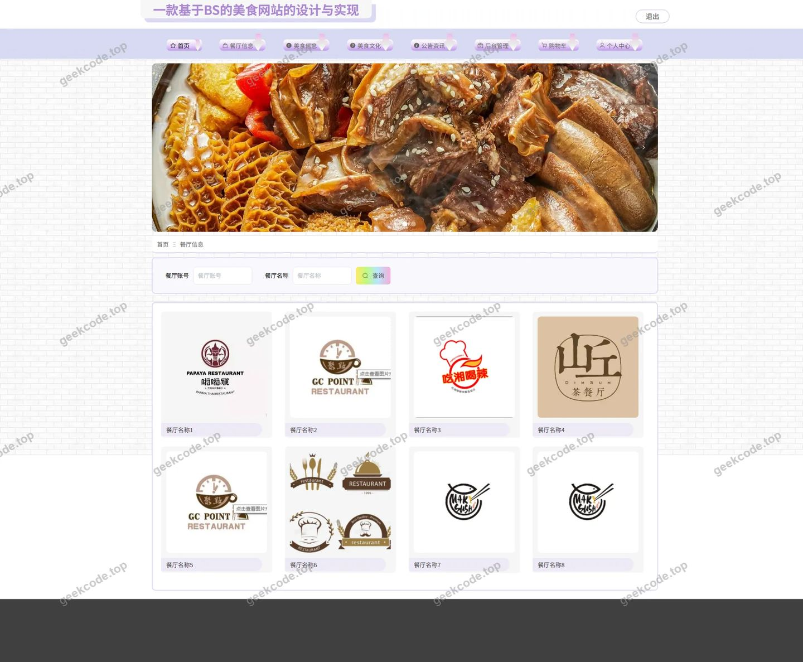</a>

<h4>前台-美食文化列表</h4>

<a href="https://geekcode.top/archives/%E4%B8%80%E6%AC%BE%E5%9F%BA%E4%BA%8EBS%E7%9A%84%E7%BE%8E%E9%A3%9F%E7%BD%91%E7%AB%99%E7%9A%84%E8%AE%BE%E8%AE%A1%E4%B8%8E%E5%AE%9E%E7%8E%B0-%E8%AE%BA%E6%96%87?utm_source=github" title="查看完整源码">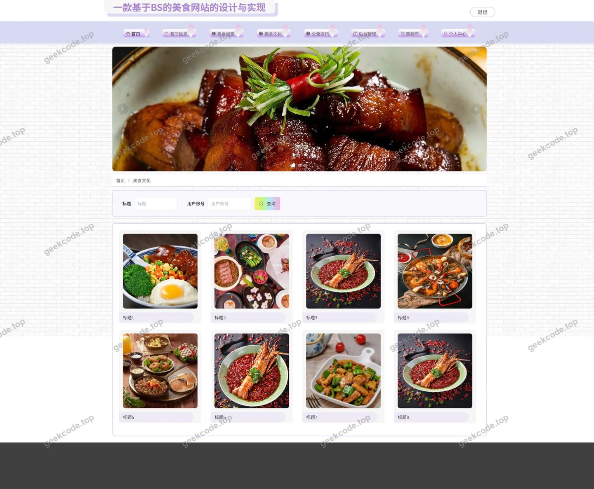</a>

<h4>前台-美食信息列表</h4>

<a href="https://geekcode.top/archives/%E4%B8%80%E6%AC%BE%E5%9F%BA%E4%BA%8EBS%E7%9A%84%E7%BE%8E%E9%A3%9F%E7%BD%91%E7%AB%99%E7%9A%84%E8%AE%BE%E8%AE%A1%E4%B8%8E%E5%AE%9E%E7%8E%B0-%E8%AE%BA%E6%96%87?utm_source=github" title="查看完整源码">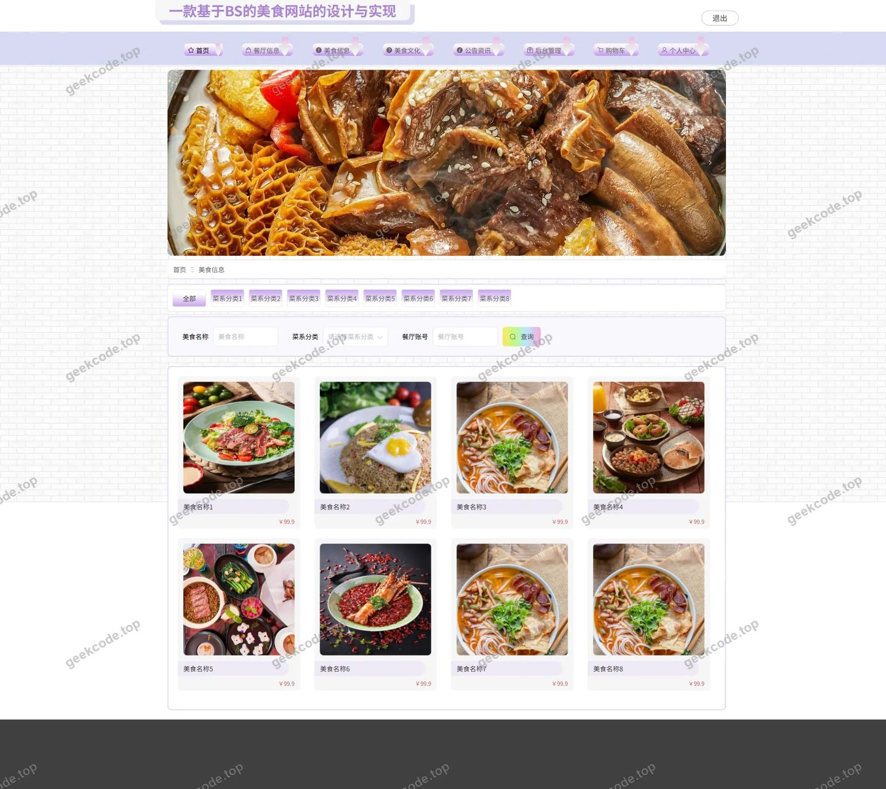</a>

<h4>前台-收藏列表</h4>

<a href="https://geekcode.top/archives/%E4%B8%80%E6%AC%BE%E5%9F%BA%E4%BA%8EBS%E7%9A%84%E7%BE%8E%E9%A3%9F%E7%BD%91%E7%AB%99%E7%9A%84%E8%AE%BE%E8%AE%A1%E4%B8%8E%E5%AE%9E%E7%8E%B0-%E8%AE%BA%E6%96%87?utm_source=github" title="查看完整源码">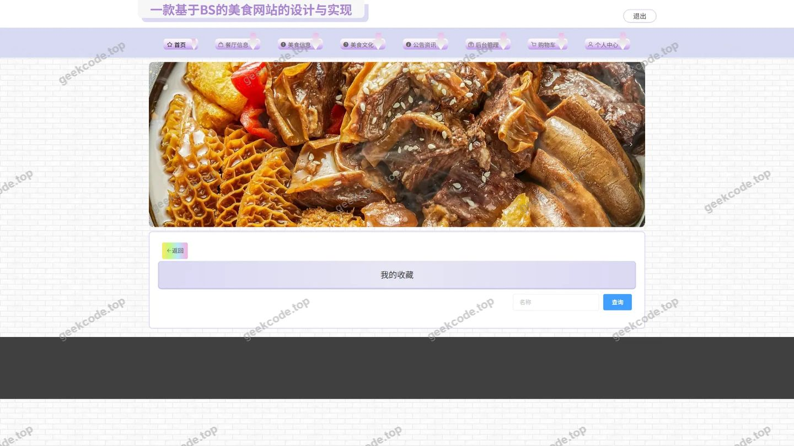</a>

<h4>前台-个人中心</h4>

<h4>前台-公告列表</h4>

<a href="https://geekcode.top/archives/%E4%B8%80%E6%AC%BE%E5%9F%BA%E4%BA%8EBS%E7%9A%84%E7%BE%8E%E9%A3%9F%E7%BD%91%E7%AB%99%E7%9A%84%E8%AE%BE%E8%AE%A1%E4%B8%8E%E5%AE%9E%E7%8E%B0-%E8%AE%BA%E6%96%87?utm_source=github" title="查看完整源码">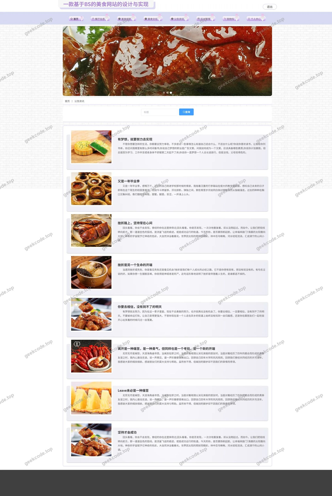</a>

<h3>后台管理端</h3>
<h4>后台-关于我们</h4>

<a href="https://geekcode.top/archives/%E4%B8%80%E6%AC%BE%E5%9F%BA%E4%BA%8EBS%E7%9A%84%E7%BE%8E%E9%A3%9F%E7%BD%91%E7%AB%99%E7%9A%84%E8%AE%BE%E8%AE%A1%E4%B8%8E%E5%AE%9E%E7%8E%B0-%E8%AE%BA%E6%96%87?utm_source=github" title="查看完整源码">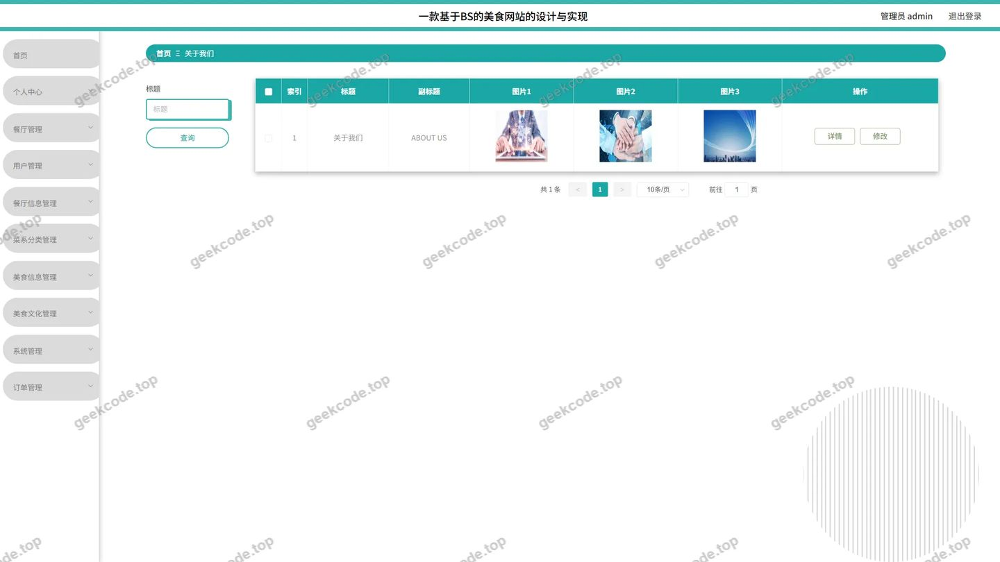</a>

<h4>后台-菜系分类</h4>

<a href="https://geekcode.top/archives/%E4%B8%80%E6%AC%BE%E5%9F%BA%E4%BA%8EBS%E7%9A%84%E7%BE%8E%E9%A3%9F%E7%BD%91%E7%AB%99%E7%9A%84%E8%AE%BE%E8%AE%A1%E4%B8%8E%E5%AE%9E%E7%8E%B0-%E8%AE%BA%E6%96%87?utm_source=github" title="查看完整源码">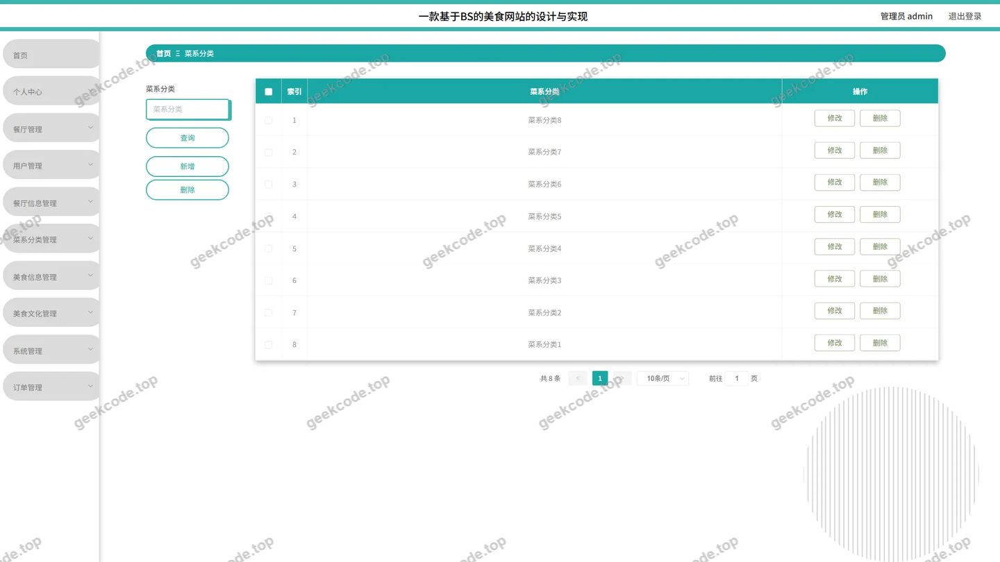</a>

<h4>后台-餐厅</h4>

<a href="https://geekcode.top/archives/%E4%B8%80%E6%AC%BE%E5%9F%BA%E4%BA%8EBS%E7%9A%84%E7%BE%8E%E9%A3%9F%E7%BD%91%E7%AB%99%E7%9A%84%E8%AE%BE%E8%AE%A1%E4%B8%8E%E5%AE%9E%E7%8E%B0-%E8%AE%BA%E6%96%87?utm_source=github" title="查看完整源码">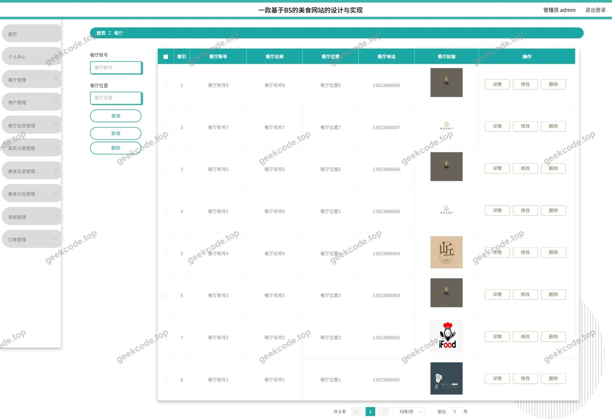</a>

<h4>后台-餐厅信息</h4>

<a href="https://geekcode.top/archives/%E4%B8%80%E6%AC%BE%E5%9F%BA%E4%BA%8EBS%E7%9A%84%E7%BE%8E%E9%A3%9F%E7%BD%91%E7%AB%99%E7%9A%84%E8%AE%BE%E8%AE%A1%E4%B8%8E%E5%AE%9E%E7%8E%B0-%E8%AE%BA%E6%96%87?utm_source=github" title="查看完整源码">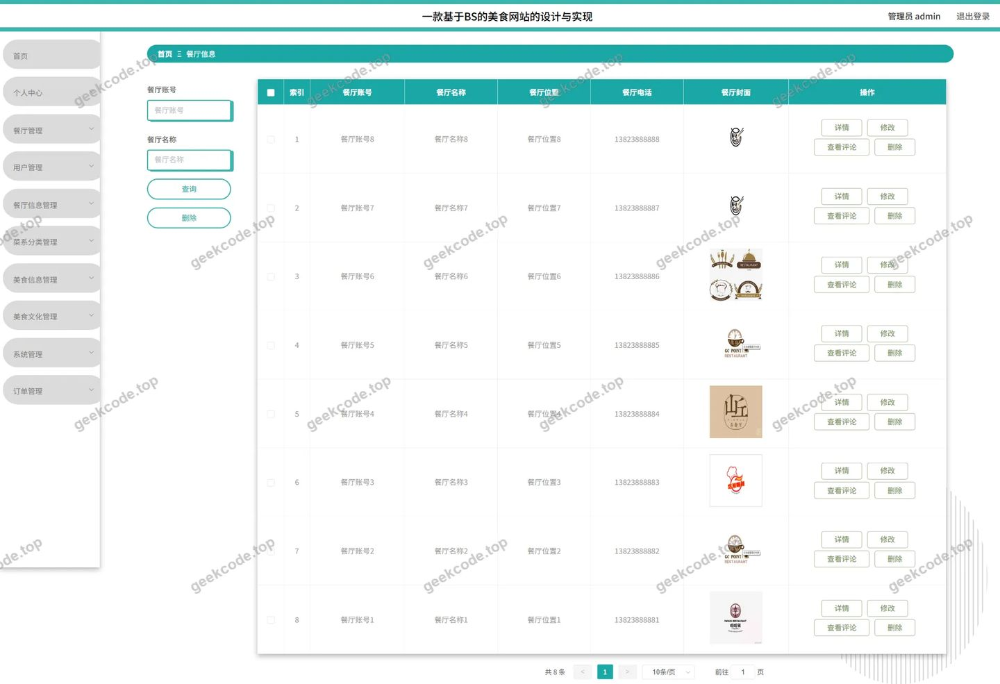</a>

<h4>后台-系统配置</h4>

<a href="https://geekcode.top/archives/%E4%B8%80%E6%AC%BE%E5%9F%BA%E4%BA%8EBS%E7%9A%84%E7%BE%8E%E9%A3%9F%E7%BD%91%E7%AB%99%E7%9A%84%E8%AE%BE%E8%AE%A1%E4%B8%8E%E5%AE%9E%E7%8E%B0-%E8%AE%BA%E6%96%87?utm_source=github" title="查看完整源码">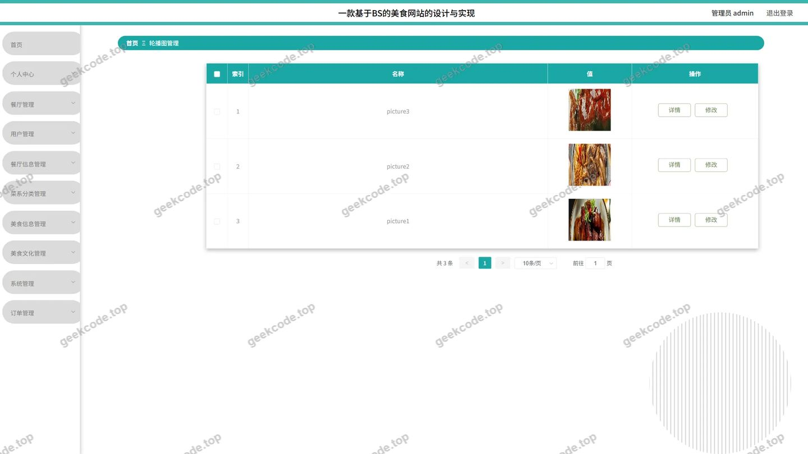</a>

<h4>后台-餐厅信息评论</h4>

<a href="https://geekcode.top/archives/%E4%B8%80%E6%AC%BE%E5%9F%BA%E4%BA%8EBS%E7%9A%84%E7%BE%8E%E9%A3%9F%E7%BD%91%E7%AB%99%E7%9A%84%E8%AE%BE%E8%AE%A1%E4%B8%8E%E5%AE%9E%E7%8E%B0-%E8%AE%BA%E6%96%87?utm_source=github" title="查看完整源码">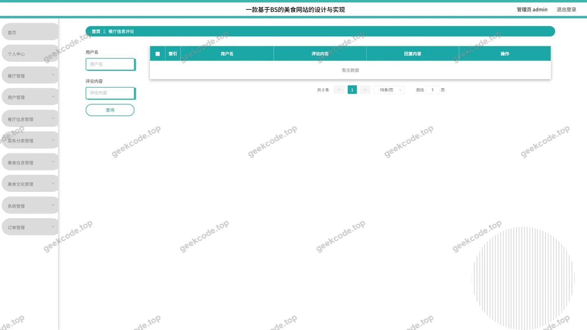</a>

<h4>后台-美食文化评论</h4>

<h4>后台-美食信息评论</h4>

<h4>后台首页</h4>

<a href="https://geekcode.top/archives/%E4%B8%80%E6%AC%BE%E5%9F%BA%E4%BA%8EBS%E7%9A%84%E7%BE%8E%E9%A3%9F%E7%BD%91%E7%AB%99%E7%9A%84%E8%AE%BE%E8%AE%A1%E4%B8%8E%E5%AE%9E%E7%8E%B0-%E8%AE%BA%E6%96%87?utm_source=github" title="查看完整源码">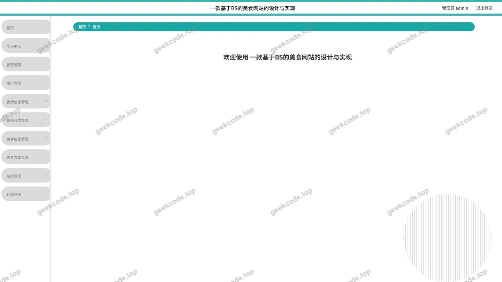</a>

<h4>后台-登录</h4>

<a href="https://geekcode.top/archives/%E4%B8%80%E6%AC%BE%E5%9F%BA%E4%BA%8EBS%E7%9A%84%E7%BE%8E%E9%A3%9F%E7%BD%91%E7%AB%99%E7%9A%84%E8%AE%BE%E8%AE%A1%E4%B8%8E%E5%AE%9E%E7%8E%B0-%E8%AE%BA%E6%96%87?utm_source=github" title="查看完整源码">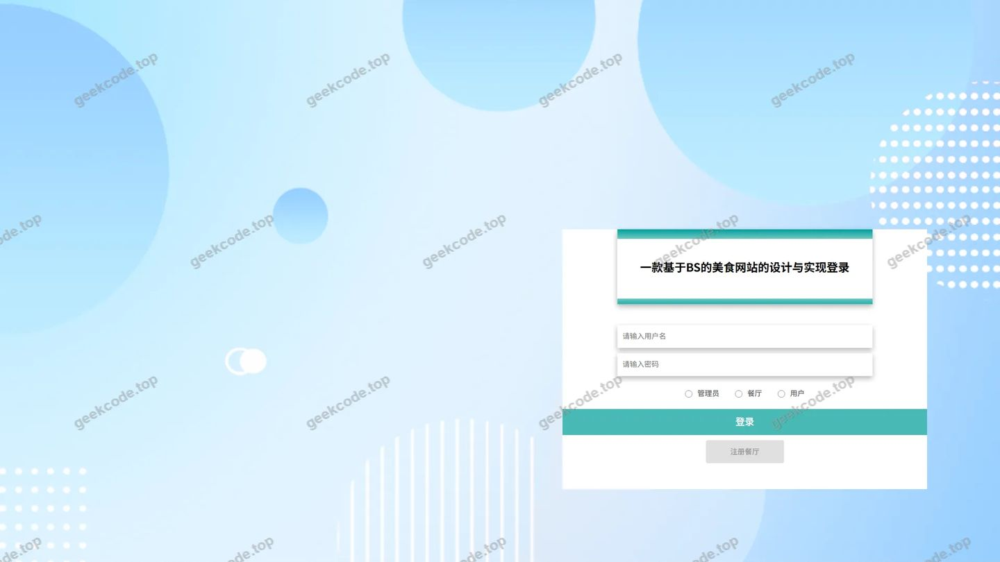</a>

<h4>后台-美食文化</h4>

<a href="https://geekcode.top/archives/%E4%B8%80%E6%AC%BE%E5%9F%BA%E4%BA%8EBS%E7%9A%84%E7%BE%8E%E9%A3%9F%E7%BD%91%E7%AB%99%E7%9A%84%E8%AE%BE%E8%AE%A1%E4%B8%8E%E5%AE%9E%E7%8E%B0-%E8%AE%BA%E6%96%87?utm_source=github" title="查看完整源码">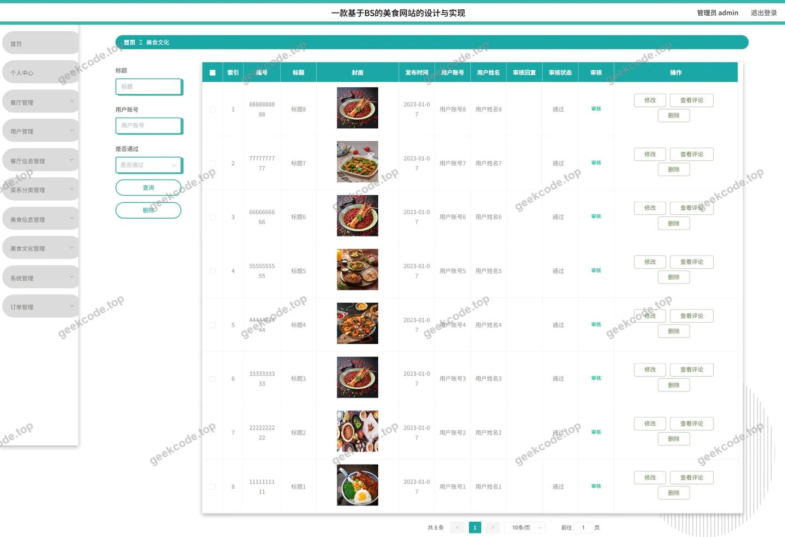</a>

<h4>后台-美食信息</h4>

<a href="https://geekcode.top/archives/%E4%B8%80%E6%AC%BE%E5%9F%BA%E4%BA%8EBS%E7%9A%84%E7%BE%8E%E9%A3%9F%E7%BD%91%E7%AB%99%E7%9A%84%E8%AE%BE%E8%AE%A1%E4%B8%8E%E5%AE%9E%E7%8E%B0-%E8%AE%BA%E6%96%87?utm_source=github" title="查看完整源码">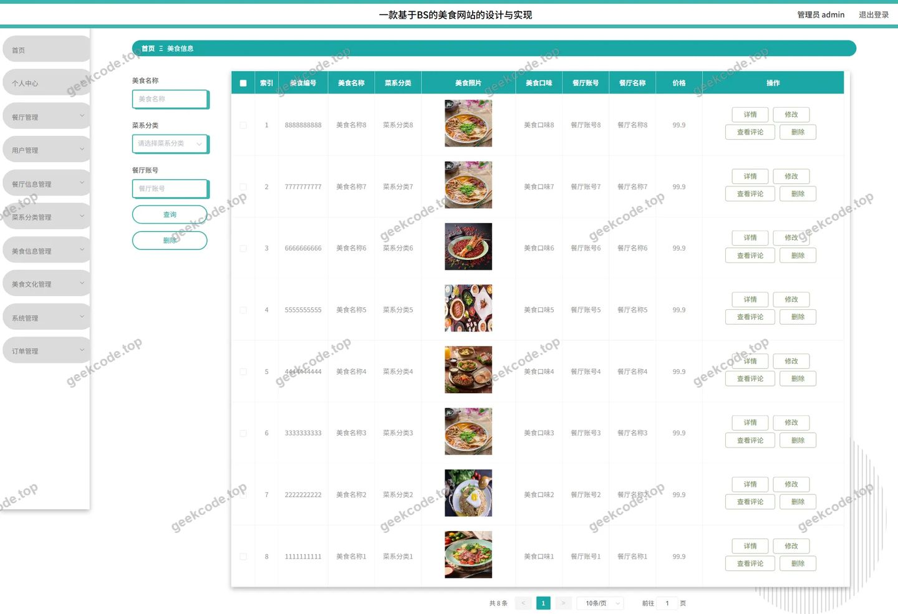</a>

<h4>后台-公告信息</h4>

<a href="https://geekcode.top/archives/%E4%B8%80%E6%AC%BE%E5%9F%BA%E4%BA%8EBS%E7%9A%84%E7%BE%8E%E9%A3%9F%E7%BD%91%E7%AB%99%E7%9A%84%E8%AE%BE%E8%AE%A1%E4%B8%8E%E5%AE%9E%E7%8E%B0-%E8%AE%BA%E6%96%87?utm_source=github" title="查看完整源码">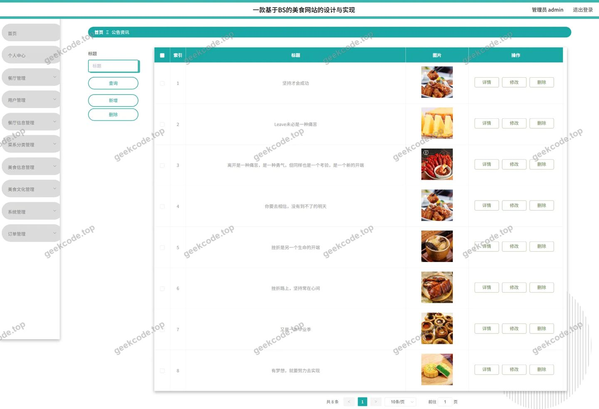</a>

<h4>后台-订单-状态</h4>

<a href="https://geekcode.top/archives/%E4%B8%80%E6%AC%BE%E5%9F%BA%E4%BA%8EBS%E7%9A%84%E7%BE%8E%E9%A3%9F%E7%BD%91%E7%AB%99%E7%9A%84%E8%AE%BE%E8%AE%A1%E4%B8%8E%E5%AE%9E%E7%8E%B0-%E8%AE%BA%E6%96%87?utm_source=github" title="查看完整源码">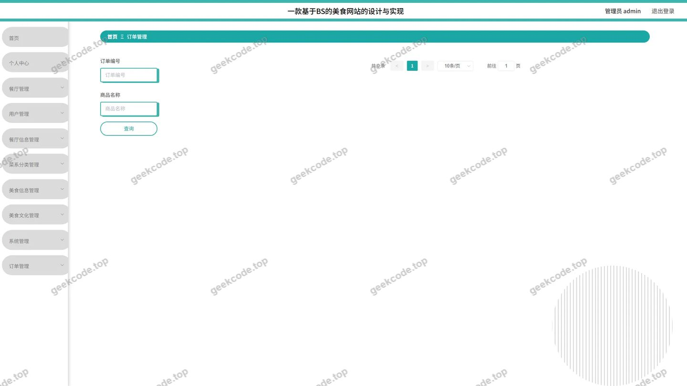</a>

---

## 获取完整源码

| 项目 | 说明 |
| --- | --- |
| 项目名 | 一款基于BS的美食网站的设计与实现--论文 |
| 运行截图 | 本文 23 张（站点带水印原图，仓库 `images/` 目录） |
| 完整源码 | [https://geekcode.top/archives/%E4%B8%80%E6%AC%BE%E5%9F%BA%E4%BA%8EBS%E7%9A%84%E7%BE%8E%E9%A3%9F%E7%BD%91%E7%AB%99%E7%9A%84%E8%AE%BE%E8%AE%A1%E4%B8%8E%E5%AE%9E%E7%8E%B0-%E8%AE%BA%E6%96%87?utm_source=github](https://geekcode.top/archives/%E4%B8%80%E6%AC%BE%E5%9F%BA%E4%BA%8EBS%E7%9A%84%E7%BE%8E%E9%A3%9F%E7%BD%91%E7%AB%99%E7%9A%84%E8%AE%BE%E8%AE%A1%E4%B8%8E%E5%AE%9E%E7%8E%B0-%E8%AE%BA%E6%96%87?utm_source=github) |
| 咨询微信 | **ir9372**（备注：jingpin-yuanma） |
| 更多项目 | [极客代码 geekcode.top](https://geekcode.top/?utm_source=github) |

> 需要源码、部署、改配置、跑不起来等问题，加微信 ir9372 沟通，说明项目名即可。
